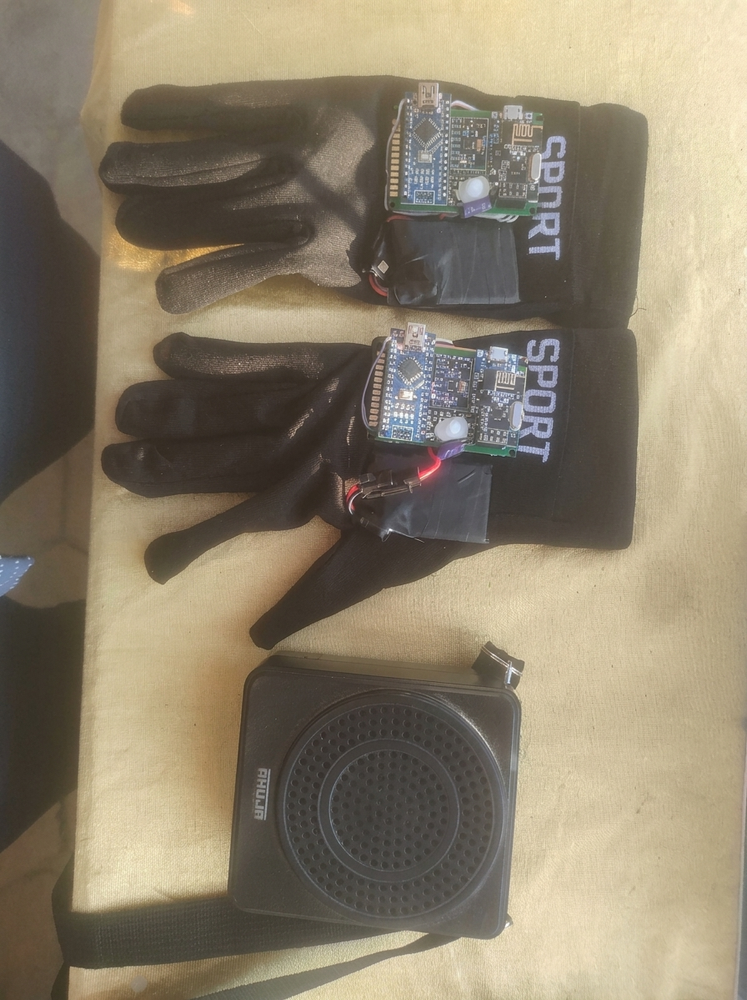
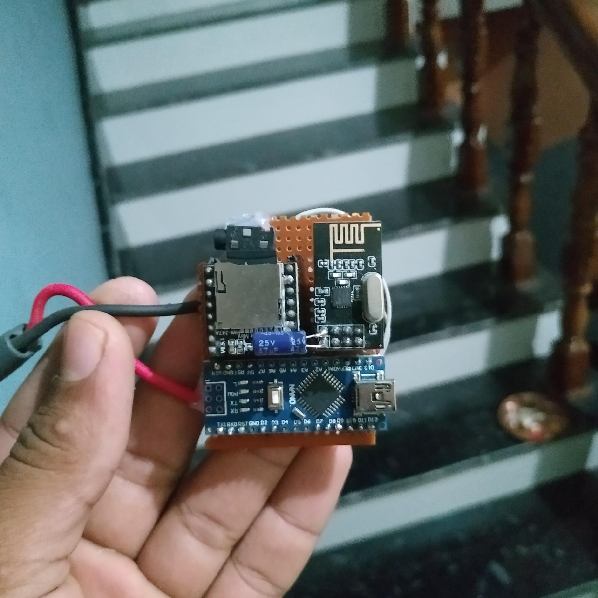
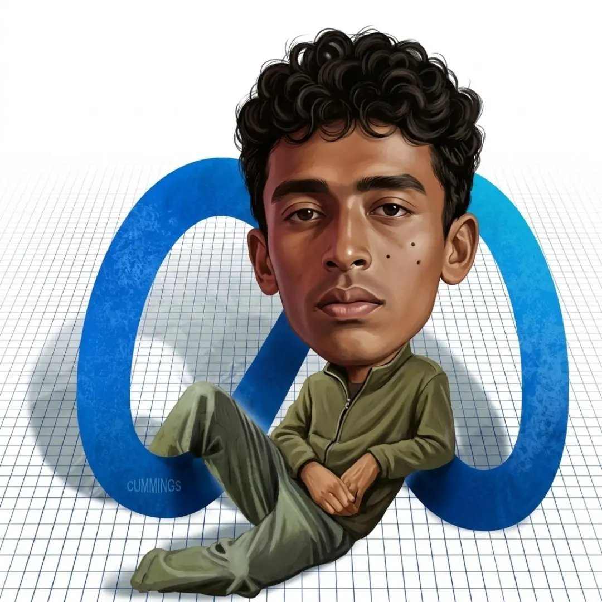
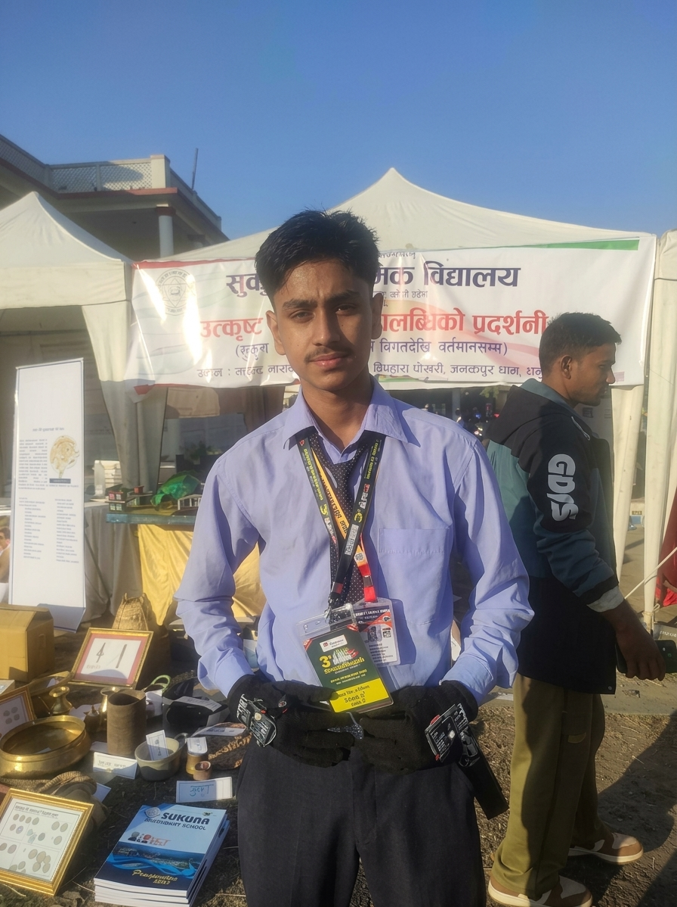

# Vocal Gloves

**A wearable gesture-based communication system**

Vocal Gloves is an assistive-technology project designed to translate hand movements into spoken audio prompts. Two sensor-equipped gloves detect gestures and communicate wirelessly with a receiver, which selects and plays the corresponding voice recording.

The project is being developed with accessible, low-cost embedded hardware, with the goal of making everyday communication easier for people who may have difficulty speaking.

> **Development status:** The project is under development. The left-glove firmware is currently a placeholder; its implementation will be added separately. Hardware, gesture recognition, and audio playback should be tested together before real-world use.

---

## Project Gallery

<p align="center">
  
  &nbsp;
  
</p>
<p align="center">
  <sub>Project overview</sub>
  &nbsp;&nbsp;&nbsp;&nbsp;&nbsp;&nbsp;
  <sub>Wireless audio receiver</sub>
</p>

**Add your images:** upload the two photos to `assets/images/` using the exact filenames shown above. You can change the displayed image width by editing the `width` values in this section.

## Project Creators

<p align="center">
  <a href="docs/project-creator.md">Meet the project creators</a>
</p>
<table>
  <tr>
    <td align="center" width="50%">
      
      <br />
      <strong>Yugansu Rijal</strong>
    </td>
    <td align="center" width="50%">
      
      <br />
      <strong>Suprim Ojha</strong>
    </td>
  </tr>
</table>

Upload each creator's photo to `assets/images/` with the matching filename. The images are displayed at **180 pixels wide**; change the `width="180"` attribute above to adjust their size.

---

## How It Works

1. **Motion sensing** — MPU6050 sensors measure hand movement and orientation.
2. **Gesture recognition** — The Arduino Nano processes sensor readings to identify a configured gesture.
3. **Wireless transmission** — nRF24L01 radio modules send gesture data from each glove to the receiver.
4. **Audio playback** — The receiver maps the gesture to an audio track and plays the selected prompt through the DFPlayer Mini.

### System Overview

| Unit | Main responsibility |
|---|---|
| Left glove | Detects left-hand gestures and sends gesture data |
| Right glove | Detects right-hand gestures and sends gesture data |
| Receiver | Receives gesture packets and plays the mapped audio prompt |

The current receiver firmware is organized for gesture IDs **G01–G06** from the left glove and **G07–G12** from the right glove. The receiver uses audio folder **01** for Nepali and **02** for English.

## Hardware

### Each glove (left and right)

| Component | Quantity | Purpose |
|---|---:|---|
| Arduino Nano | 1 | Microcontroller |
| MPU6050 | 1 | Accelerometer and gyroscope |
| nRF24L01 | 1 | Wireless data transmission |
| TP4056 LiPo charging module | 1 | Battery charging |
| Voltage booster module | 1 | Power conversion |
| 500mAh 3.7V LiPo battery | 1 | Portable power |

### Receiver

| Component | Quantity | Purpose |
|---|---:|---|
| Arduino Nano | 1 | Receiver controller |
| nRF24L01 | 1 | Wireless data reception |
| microSD card | 1 | Audio-track storage |
| DFPlayer Mini | 1 | Audio playback |
| AUX female port | 1 | Audio output connection |
| TP4056 LiPo charging module | 1 | Battery charging |
| 500mAh 3.7V LiPo battery | 1 | Portable power |

## Firmware

```text
Vocal-Gloves/
├── assets/
│   └── images/
│       ├── vocal-gloves-overview.jpg
│       ├── vocal-gloves-receiver.jpg
│       ├── yugansu-rijal.jpg
│       └── suprim-ojha.jpg
├── docs/
│   └── project-creator.md
├── firmware/
│   ├── left_glove/
│   │   └── left_glove.ino
│   ├── right_glove/
│   │   └── right_glove.ino
│   └── receiver/
│       └── receiver.ino
├── LICENSE
└── README.md
```

| Firmware file | Purpose | Status |
|---|---|---|
| `firmware/left_glove/left_glove.ino` | Left-hand gesture sensing and transmission | Placeholder |
| `firmware/right_glove/right_glove.ino` | Right-hand gesture sensing and transmission | Initial implementation |
| `firmware/receiver/receiver.ino` | Wireless reception and audio playback | Initial implementation |

## Software Setup

1. Install the Arduino IDE.
2. Install the **RF24** library by TMRh20 using Library Manager.
3. Install **DFRobotDFPlayerMini** using Library Manager.
4. Open the relevant `.ino` file from the `firmware/` directory.
5. Select the correct Arduino Nano board and processor/bootloader option for your specific Nano.
6. Verify the pin connections and power requirements before uploading firmware.

The sketches also use Arduino core libraries such as `Wire`, `SPI`, and `SoftwareSerial`, where applicable.

## Audio File Organization

The receiver firmware selects language folders on the microSD card:

- `01` — Nepali prompts
- `02` — English prompts

Place numbered audio tracks in the corresponding folders so that each track number matches its gesture ID. Check the DFPlayer Mini documentation and the receiver sketch for the exact supported audio format and naming convention.

## Hardware and Safety Notes

- **nRF24L01 power:** The radio module uses 3.3V. Never connect its VCC pin to the Nano's 5V supply. Use a stable 3.3V source suitable for the module.
- **Battery charging:** Use a TP4056 module compatible with the selected LiPo cell. Do not charge damaged, swollen, or overheated batteries.
- **Voltage conversion:** Confirm the voltage-booster output and the input-voltage requirements of each connected module before powering the circuit.
- **Wiring:** Confirm the actual pinout of each board and module. Do not assume all Nano boards or module breakouts have identical layouts.
- **Testing:** Test each subsystem separately before wearing the gloves or relying on the system.

## Current Limitations

- Left-glove firmware has not yet been implemented.
- Gesture recognition may require calibration and testing for different users and wearing positions.
- Audio prompts must be recorded, named, and copied to the microSD card.
- The system is a development prototype and is not a certified medical or emergency communication device.

## Contributing

Suggestions, bug reports, hardware test results, and improvements are welcome. Keep changes organized by subsystem and document wiring, gesture mappings, and firmware behavior when making updates.

## License

This project is distributed under the [MIT License](LICENSE).
